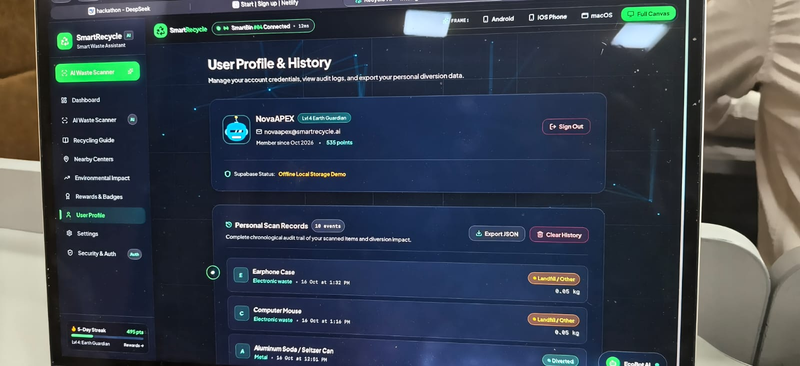
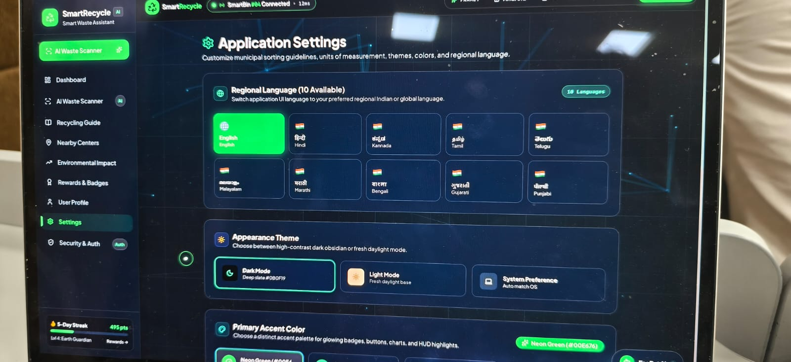
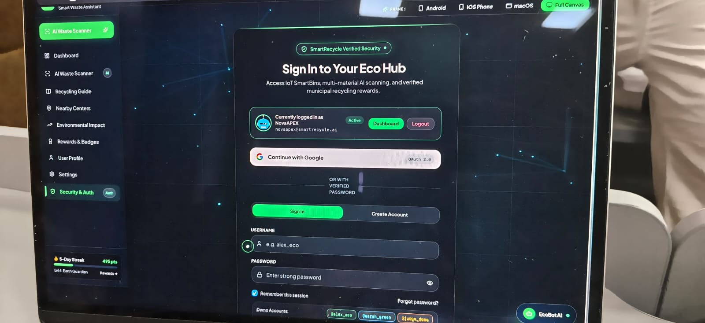
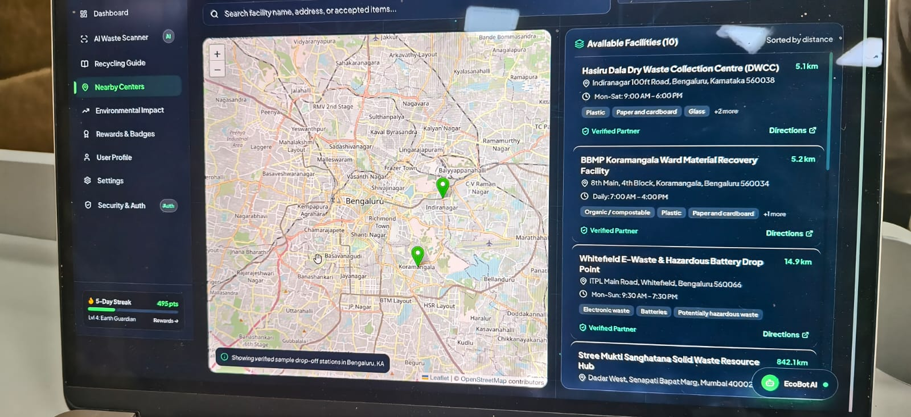
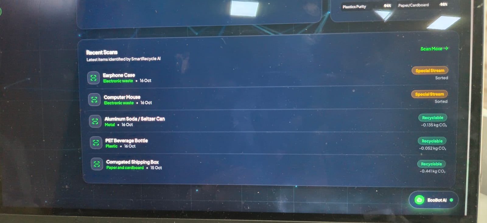

# ♻️ Smart Recycling Assistant

> AI that turns any waste item into accurate, RAG-grounded disposal guidance. 4,249 items, 105 recycling guidelines, live CO₂ impact. Runs on-device.

## Architecture

Person 3 (React Frontend)  ->  Person 2 (FastAPI + AI Brain)  ->  Person 1 (Vision)

## 📊 Verified Metrics

| Metric | Value |
|--------|------:|
| Curated waste items | 4,249 |
| RAG guideline chunks | 105 |
| API endpoints | 18 |
| Tests passing | 94+ |
| Tip quality | 4.83 / 5.00 |
| Cache speedup | 4,009x |

## 📁 Structure

- person1-vision/ - Qwen3-VL + Qwen2.5VL vision classifier
- person2-brain/ - FastAPI + RAG + 4,249-item DB (18 endpoints)
- person3-frontend/ - React 19 + TypeScript + Tailwind UI

## 🚀 Quick Start

### 1. Ollama
ollama serve
ollama pull qwen2.5:7b
ollama pull qwen3-vl:4b
ollama pull nomic-embed-text

### 2. Backend
cd person2-brain
pip3 install fastapi uvicorn pillow requests
python3 api.py

### 3. Frontend
cd person3-frontend
npm install
echo "VITE_API_BASE_URL=http:http://127.0.0.1:8000/docs" > .env
npm run dev

## 🧪 Testing

cd person2-brain
python3 test_person2_unit.py
python3 test_backend.py

## 🌐 Live Frontend

**Try it now:** [https://smart-recycling-assistant-76.netlify.app](https://smart-recycling-assistant-76.netlify.app)

> **Note:** The Netlify deploy shows the full UI. For live AI classification, run the backend locally (see Quick Start) — the API runs on-device via Ollama.

---

## 🎬 Demo Video

**▶️ [Watch on YouTube](https://youtu.be/Ei279IasJ20)** · 2:47 min

Full walkthrough: React frontend → FastAPI backend → RAG-grounded tips → live CO₂ impact tracking.

---

## 📸 Screenshots

### 1. Person 3 Frontend — AI Waste Scanner

### 2. Person 2 Backend — Battery API Response

### 3. Swagger UI — 18 Endpoints

### 4. Person 1 Vision — Standalone Classifier

### 5. Live LAN Demo — Cross-Machine

---

## 📜 License

MIT - see LICENSE.
